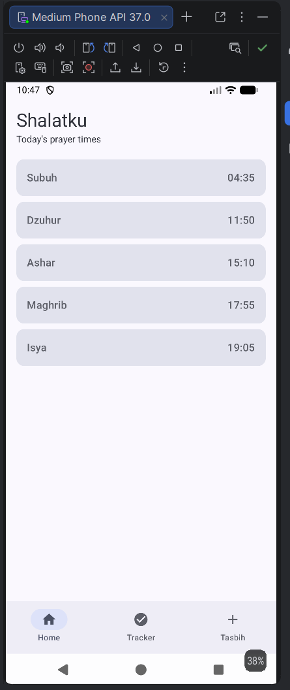
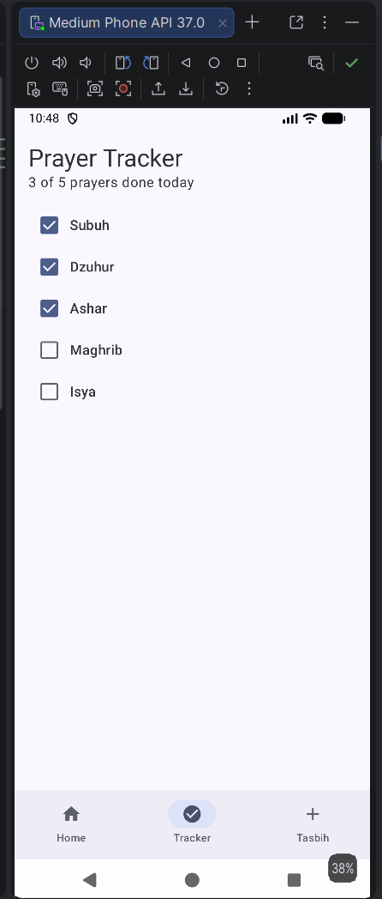
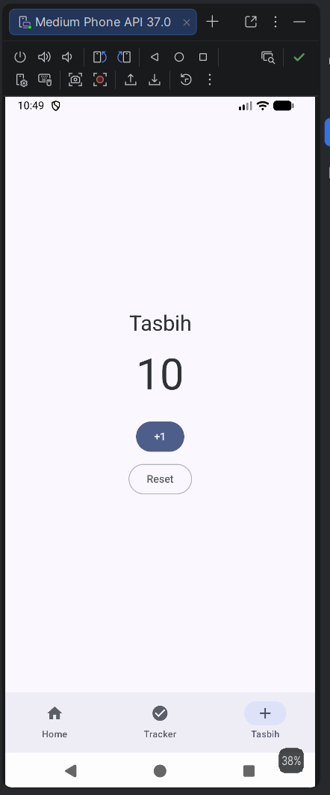

# Shalatku

A beginner Jetpack Compose app that shows daily prayer times, lets the user track
which prayers are done, and includes a simple tasbih counter. Built for the
Mobile Application Development course (Meeting 9: State Management and User Interaction).

## Screenshots

| Home | Tracker | Tasbih |
|---|---|---|
|  |  |  |

## Features

- **Home:** shows today's five prayer times (Subuh, Dzuhur, Ashar, Maghrib, Isya) as cards.
- **Tracker:** a checklist where the user ticks each prayer, with a progress text such as
  "2 of 5 prayers done today".
- **Tasbih:** a counter with a +1 button and a Reset button.
- **Bottom navigation bar** to switch between the three screens.

The prayer times are fixed sample data (`samplePrayers` in `Prayer.kt`), not real-time data.

## Concepts practised

| Screen | Concept |
|---|---|
| Home | Showing data in a screen with a data class and a list |
| Tracker | State hoisting: the screen receives the state and an `onToggle` function from its parent |
| Tasbih | Local state with `remember` and `mutableStateOf` |

Where the state lives matters:
- The Tracker progress is kept in `ShalatkuApp`, above all screens, so it stays when the user
  switches tabs.
- The Tasbih counter is kept inside `TasbihScreen`, so it resets to 0 when the user leaves
  that tab and comes back.
- State is stored with `remember`, so it is lost when the app is closed or the screen rotates.

## Project structure

```
app/src/main/java/com/example/shalatku/
├── MainActivity.kt      # entry point, bottom bar, and screen switching (ShalatkuApp)
├── Prayer.kt            # Prayer data class and sample prayer times
├── HomeScreen.kt        # Screen 1: prayer time cards
├── TrackerScreen.kt     # Screen 2: prayer checklist and progress text
├── TasbihScreen.kt      # Screen 3: counter with +1 and Reset
└── ui/theme/            # generated Material 3 theme
```

## Tech stack

- Kotlin
- Jetpack Compose with Material 3
- Android Studio (Minimum SDK: API 24)

## How to run

1. Clone this repository and open it in Android Studio.
2. Wait for the Gradle sync to finish.
3. Select an emulator or a connected Android device.
4. Press **Run ▶**.

## Testing

The app was tested manually on the Android Emulator (Medium Phone API 37.0): all three screens
display correctly, navigation works, ticking prayers updates the progress text, and the tasbih
counter increases and resets.

## Author

Farrel Faza