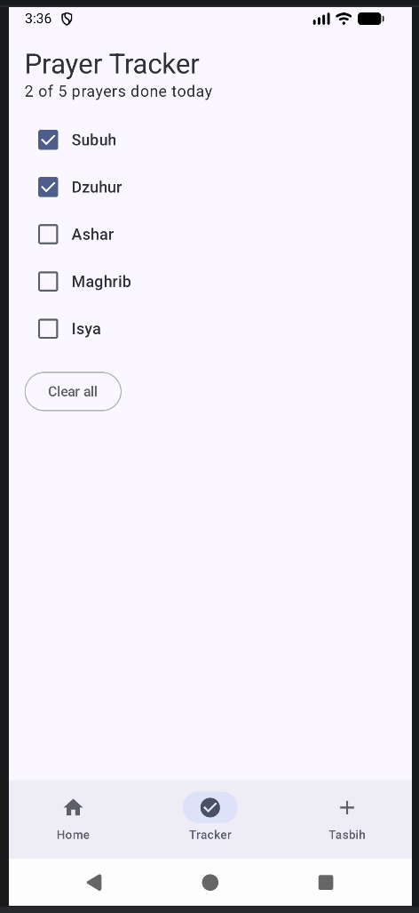
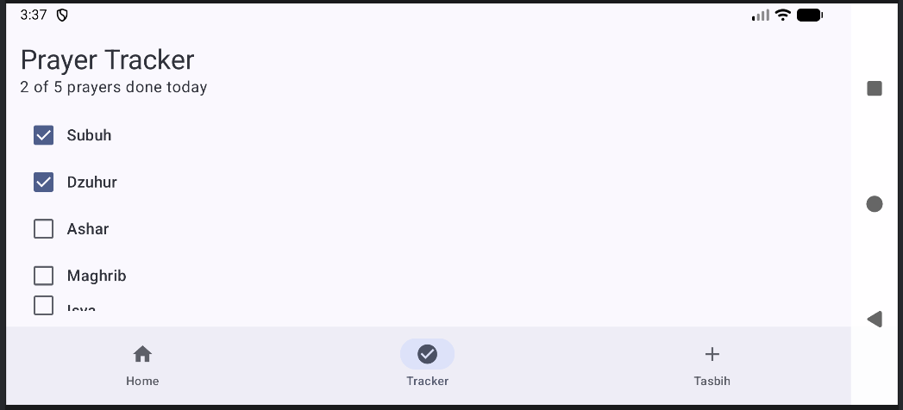
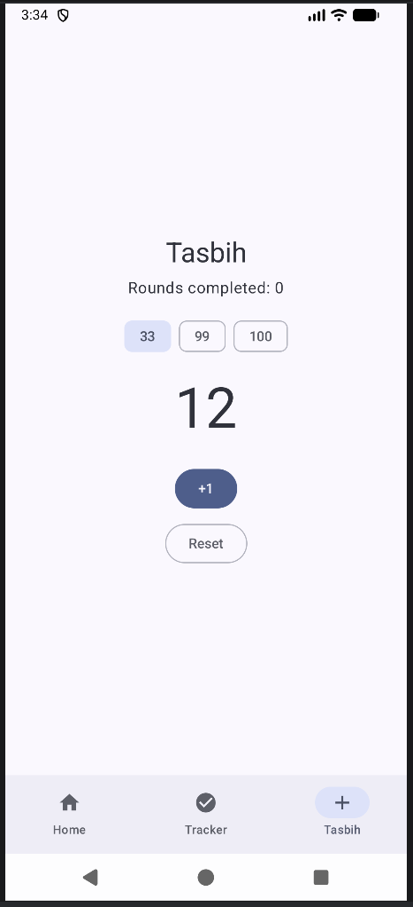
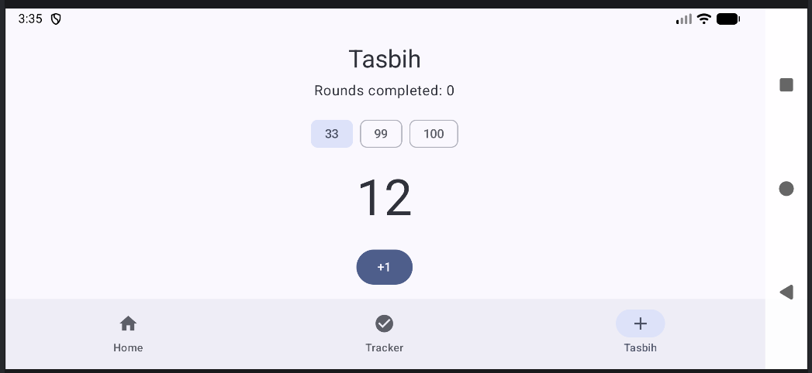
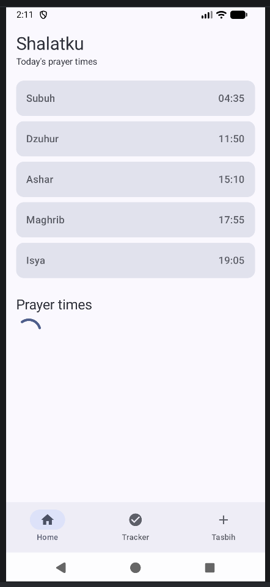
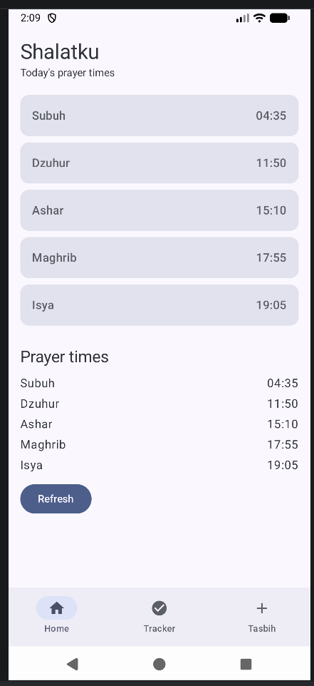
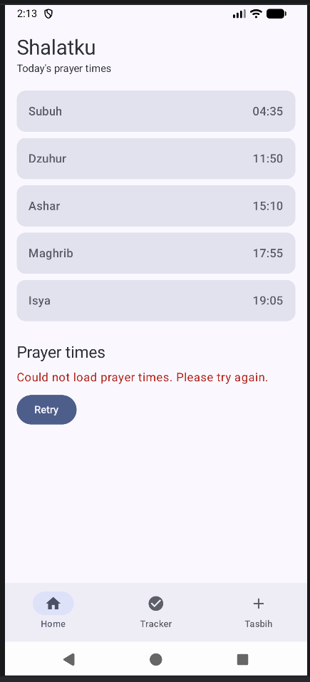

# Shalatku

A beginner Jetpack Compose app that shows daily prayer times, lets the user track
which prayers are done, and includes a simple tasbih counter. Built for the
Mobile Application Development course (Meeting 9: State Management and User Interaction,
extended in Meeting 12: ViewModel and Meeting 13: UI State and StateFlow).

## Screenshots

| Home | Tracker | Tasbih |
|---|---|---|
|  |  |  |

### Rotation test (state survives rotation)

| Screen | Portrait | Landscape |
|---|---|---|
| Tracker |  |  |
| Tasbih |  |  |

### Prayer times: Loading, Success and Error

| Loading | Success | Error |
|---|---|---|
|  |  |  |

## Features

- **Home:** shows today's five prayer times (Subuh, Dzuhur, Ashar, Maghrib, Isya) as cards,
  followed by a **Prayer times** section that pretends to fetch the times.
- **Prayer times section:** shows a progress indicator while loading, the list of times with
  a **Refresh** button on success, and an error message with a **Retry** button on failure.
  The loading is simulated with a 1.5 second delay, and every second request fails on purpose
  to demonstrate the error state.
- **Tracker:** a checklist where the user ticks each prayer, with a progress text such as
  "2 of 5 prayers done today", and a **Clear all** button.
- **Tasbih:** a counter with a +1 button and a Reset button. The user can choose a round
  size of 33, 99 or 100. Reaching the round size starts a new round and adds one to
  "Rounds completed".
- **Bottom navigation bar** to switch between the three screens.
- Screens can be scrolled, so every button stays reachable in landscape mode.

The prayer times are fixed sample data (`samplePrayers` in `Prayer.kt`), not real-time data.

## Architecture (MVVM, simplified)

| Layer | Job | In Shalatku |
|---|---|---|
| Model | what the data is | `Prayer`, `samplePrayers` |
| ViewModel | holds UI state and applies the app rules | `SalatKuViewModel` |
| View | draws state and reports taps | `HomeScreen`, `TrackerScreen`, `TasbihScreen`, `PrayerTimesSection`, `ShalatkuApp` |

`SalatKuViewModel` keeps **one immutable `SalatKuUiState`** inside a `MutableStateFlow` and
exposes it as a read-only `StateFlow`. `ShalatkuApp` reads it with
`collectAsStateWithLifecycle()` and passes plain values and lambdas to the screens, never the
ViewModel. State goes down, events go up.

The rules live in the ViewModel:
- A tasbih round ends when the count reaches the round size.
- Changing the round size resets the current count but keeps the completed rounds.
- **Clear all** removes every ticked prayer.
- `loadPrayerTimes()` sets the state to Loading, waits, then sets Success or Error. It does
  nothing if a load is already running, and it is only called when the user presses a button.

## State handling

- `SalatKuUiState` is a `data class` with only `val` fields and read-only `List`s. Every change
  builds a new object with `copy()` inside `update { }`.
- The prayer times use a sealed type, `PrayerTimesUiState` (`Loading`, `Success`, `Error`),
  so impossible combinations such as loading and error at the same time cannot exist, and the
  `when` in `PrayerTimesSection` has no `else` branch.
- `doneCount` is a computed property of the state, not a stored field, so it cannot go out of
  sync with the list of ticked prayers.
- The ViewModel is obtained with `viewModel()` and is never created with a constructor, so its
  state survives screen rotation and tab changes.
- The selected bottom-bar tab is UI-only state and is kept in `ShalatkuApp` with
  `rememberSaveable`.
- A ViewModel does not survive process death, so everything resets if Android kills the app.

## Project structure

```
app/src/main/java/com/example/shalatku/
├── MainActivity.kt          # entry point, bottom bar, and screen switching (ShalatkuApp)
├── SalatKuViewModel.kt      # StateFlow of the UI state and the app rules
├── SalatKuUiState.kt        # one immutable state object for the whole app
├── PrayerTimesUiState.kt    # sealed type: Loading, Success, Error
├── Prayer.kt                # Prayer data class and sample prayer times
├── HomeScreen.kt            # Screen 1: prayer time cards and the Prayer times section
├── PrayerTimesSection.kt    # shows Loading, Success or Error with Refresh / Retry
├── TrackerScreen.kt         # Screen 2: prayer checklist, progress text and Clear all
├── TasbihScreen.kt          # Screen 3: counter, round size chips, +1 and Reset
└── ui/theme/                # generated Material 3 theme
```

## Tech stack

- Kotlin
- Jetpack Compose with Material 3
- Lifecycle ViewModel, Kotlin coroutines and StateFlow
- Android Studio (Minimum SDK: API 24)

## How to run

1. Clone this repository and open it in Android Studio.
2. Wait for the Gradle sync to finish.
3. Select an emulator or a connected Android device.
4. Press **Run ▶**.

## Testing

The app was tested manually on the Android Emulator (Medium Phone API 37.0): all three
screens display correctly, navigation works, ticking prayers updates the progress text,
Clear all removes every tick, the tasbih counter increases and resets, and changing the
round size resets the count but keeps the completed rounds. In the Prayer times section,
pressing Refresh shows the loading indicator and then the times, and pressing it again shows
the error message, which Retry fixes. After rotating the emulator, including while the times
are loading, the state stays the same.

## Author

Farrel Faza